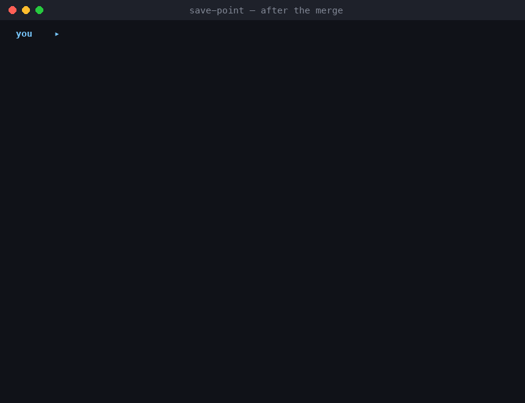

# Save Point

[](https://github.com/thierrypdamiba/save-point/actions/workflows/ci.yml)

**The 30-second comprehension check after every AI-assisted merge.**

You just merged a PR you half-read. Everyone does now: AI writes the code, you skim the diff, CI is green, ship it. The debt is invisible, and a month later you're on call for a system you can't explain. Save Point is the merge ritual that catches it while the diff is still warm:

```
you    ▸ /save-point start --diff
```

Your coding agent reads what changed and asks *you*, one source-grounded question at a time, whether you actually understood it. Your answers are recorded **verbatim and honestly labeled**, and the concepts come back on a spaced schedule (1 → 7 → 30 → 90 days) to test whether the understanding lasts. It's an [Agent Skill](https://code.claude.com/docs/en/skills) with no service, no account, and plain Markdown state on your machine.

By contract, it never writes into your repositories, never puts words in your mouth, and never pretends you knew something you were told (see [Alpha status](#alpha-status) for what "by contract" means).

## The five-minute version



Right after you merge a change you only half-read. This run is drawn from a real session on Save Point's own repo, minutes after a large refactor of it landed:

```
you    ▸ /save-point start --diff

agent  ▸ The last commit is a big one — the quiz covers everything since HEAD~1.
         World map for this diff: 4 chapters, 1 map, 1 secret, 1 boss fight
         — New Game+ locked.
         Entering Chapter 1: The rename and where state lives now.
         q001 — After this change, where does a user's runtime state live,
         what files make it up, and which of them is the one file where
         your own edits are honored as configuration?

you    ▸ (answer, in your own words)

agent  ▸ Solid. You covered the top-level split, both per-repo files, and the
         rationale.

         ⋯ (three chapters and a save point later) ⋯

         Boss fight.
         q002 — A due question from repo A surfaces while you're working in
         repo B, and you answer it on the spot. Walk me through what Save Point
         does with your answer, what it deliberately refuses to do there, and
         what happens next time you open repo A — including the failure case
         where the stored record no longer checks out.
```

If that second question makes you sweat, that's the point. Sessions end at a **save point**: what you closed, chapter status, what comes back tomorrow.

## Install

New here? Follow the [ten-minute quickstart](docs/quickstart.md), which also has troubleshooting.

One line (append `-s -- claude` to install for one host only):

```sh
curl -fsSL https://raw.githubusercontent.com/thierrypdamiba/save-point/main/install.sh | sh
```

Or as a Claude Code plugin, from inside Claude Code:

```
/plugin marketplace add thierrypdamiba/save-point
/plugin install save-point@save-point
```

Or from a checkout. Save Point is a plain skill directory, and installing is copying it where your agent looks:

```sh
git clone https://github.com/thierrypdamiba/save-point.git
cd save-point
./install.sh          # installs for every host it detects
./install.sh claude   # or pick one: claude | codex | goose
```

| Host | Skill location |
| --- | --- |
| Claude Code | `~/.claude/skills/save-point/` |
| Codex | `~/.codex/skills/save-point/` |
| Goose | `~/.agents/skills/save-point/` |

Then say `/save-point` (or just "quiz me on this repo") inside any repository, in a session started *after* the install. An already-running session won't see a newly installed skill.

To pin a version, or to upgrade or roll back, give the installer a tag or branch. It clones that ref and replaces the installed skill. Your `~/.save-point/` records are not touched. The installed version is written to `VERSION` inside the skill folder and printed on install.

```sh
./install.sh --ref v0.9.0 claude    # install exactly this tag
./install.sh --ref main claude      # back to the latest main
cat ~/.claude/skills/save-point/VERSION
```

Tags exist only when the owner publishes them. If the ref does not exist, the installer stops and leaves the current install in place.

To uninstall: `./install.sh --uninstall` (or `--uninstall claude`) removes the skill and the recall hook entry and leaves `~/.save-point/` alone. By hand: `rm -rf ~/.claude/skills/save-point` (per host), or `/plugin uninstall save-point` if you installed as a plugin. If you registered the recall hook below, remove it from `~/.claude/settings.json` too, or every prompt will complain about the missing script. Your answers and recall schedule live in `~/.save-point/`, so delete that too if you want them gone.

### Unsolicited recall is on by default (Claude Code)

The installer (and the plugin) registers the bundled boundary check as a prompt hook, so the spaced schedule is delivered *to* you out of the box. It reads only scheduling frontmatter, honors every cap, and nudges the session when something is due. The skill still owns actual delivery: at most 3 prompts a day with 90-minute gaps by default, never mid-task.

Turning it off is one move, at whichever layer you prefer: say **`/save-point interruptions off`** (permanent and in-product, after which the hook stays silent), `flow 4h` to pause, or delete the Save Point entry from `hooks.UserPromptSubmit` in `~/.claude/settings.json`. If you installed by copying files yourself, or the installer couldn't touch your settings safely, this is the entry it would have added:

```json
{
  "hooks": {
    "UserPromptSubmit": [
      { "hooks": [ { "type": "command", "command": "$HOME/.claude/skills/save-point/scripts/check-due.sh" } ] }
    ]
  }
}
```

### What lives in `~/.save-point`, and why you shouldn't sync it

Plain Markdown you can read: your preferences, the recall schedule, and your verbatim answers. Be deliberate about it, because question prompts name the critical parts of each codebase, importance rankings literally tag data-loss and security paths, and `canonical_remote` records private remote hostnames. Save Point creates the directory `0700`, but dotfile sync tools don't care about your permissions, so exclude `~/.save-point` from chezmoi/Mackup/iCloud unless you mean it. Consultants juggling client repos can also set `cross_repo_recall: off` so one client's questions never surface while working for another.

For the full list of what Save Point reads, writes and sends, see [docs/security-and-privacy.md](docs/security-and-privacy.md). To report a problem, see [SECURITY.md](SECURITY.md).

### Via MCP instead

For MCP clients without native Agent Skills support, the companion server distributes the same skill through the `io.modelcontextprotocol/skills` extension (MCP `2026-07-28`), with `list_skills` / `load_skill` tools and a `save-point` prompt as the legacy path. It needs Node 20+, and you should run it from the checkout, since the server resolves the skill directory relative to its own build (set `SAVE_POINT_SKILL_DIR` to serve a skill directory from somewhere else):

```sh
cd mcp-server && npm install && npm run build
```

```json
{
  "mcpServers": {
    "save-point": {
      "command": "node",
      "args": ["/absolute/path/to/save-point/mcp-server/dist/src/index.js"]
    }
  }
}
```

## Commands

| Command | Effect |
| --- | --- |
| `/save-point` | Start or resume; pending evaluations, then due recall, then new questions |
| `/save-point start --diff [ref]` | Quiz on what changed since `ref`, as a post-merge check or a merge gate on a branch |
| `/save-point dispute q014` | Contest a verdict: the key is re-derived with evidence shown; wrong verdicts get an `amended` entry |
| `/save-point start [--level new-engineer\|maintainer\|operator]` | Full playthrough, optionally at an explicit difficulty |
| `/save-point start --doc <file-or-folder> [--sources <folder>]` | New: quiz on a written document and on whether its sources support it. No git repository needed |
| `/save-point recall` | Serve due recall now, across repositories (unless `cross_repo_recall` is off) |
| `/save-point recall --doc <file-or-folder>` | New: serve a document's due questions and grade them against its current text |
| `/save-point setup` / `settings` | Configure / inspect preferences |
| `/save-point repetition intensive\|adaptive` | Daily 30-day drilling vs. spaced (1 → 7 → 30 → 90 days) |
| `/save-point intervals 1 3 7 14 90` / `intervals default` | Use your own recall intervals, in days, in place of 1 → 7 → 30 → 90; go back to the default |
| `/save-point persona new-intern` / `persona custom <one line>` / `persona default` | Pick who asks the questions, or describe the questioner yourself; go back to the plain questioner |
| `/save-point flow 4h` / `flow today` / `resume` | Pause interruptions; resume them |
| `/save-point interruptions off\|on` | Manual-only recall, permanently |

Everything also works as plain conversation: "too hard", "less trivia", "spam me for 30 days", "pause questions until tomorrow". If chapters and boss fights aren't your thing, say "plain labels" and the game framing disappears. Every question carries a one-line HUD showing this session's tally plus the repository's lifetime numbers, and "stats off" removes it.

### Your own recall intervals

By default a question comes back after 1 day, then 7, 30 and 90 days as you keep answering it well. To use your own spacing, give the intervals in days:

```
you    ▸ /save-point intervals 1 3 7 14 90
```

A list holds 1 to 8 whole numbers of days, each from 1 to 3650, and each longer than the one before. Save Point rejects any other list, says why, and keeps the list you had. `/save-point intervals default` goes back to 1, 7, 30, 90.

Three things to know:

- Questions already scheduled keep their due dates. The new intervals apply the next time each question is rescheduled, which is the next time you answer, skip, or defer it.
- Questions marked importance 4 or 5 (core invariants, and data-loss, security, or incident paths) still never wait longer than 30 days, whatever your list says.
- Intensive mode still drills daily for 30 days. Your list applies after a question leaves intensive mode.

### Who asks the questions

You can also choose the persona that asks. Difficulty sets how hard the questions are. The persona sets who is asking and how the questions are framed. The two are separate, so any pair works.

```
you    ▸ /save-point persona new-intern
```

| Persona | How it asks |
| --- | --- |
| `default` | The plain questioner, as before. This is what you get if you set nothing |
| `new-intern` | New to the work. Asks you to explain it plainly and to say what your terms mean |
| `lead-researcher` | Senior and skeptical. Presses on evidence, alternatives, and what would change the conclusion |
| `new-teammate` | Just joined the team. Asks you to walk through the code plainly |
| `senior-reviewer` | Reviewing the work. Presses on evidence in the code, trade-offs, and what breaks |

The first two are written for documents and the last two for code, but each works in both. To describe your own, give one line of up to 200 characters:

```
you    ▸ /save-point persona custom a skeptical CFO who dislikes jargon
```

`/save-point persona default` goes back to the plain questioner.

Three things to know:

- A persona changes how questions are worded. It does not change which facts are tested, what counts as a correct answer, the grading, or the `unaided` and `assisted` labels. A friendly persona gives no more hints than the default one.
- A custom description is read as a role and a tone only. If it also says to reveal answers or to grade differently, that part is ignored.
- Changing the persona affects only the questions asked after the change. Nothing already recorded is rewritten.

### Written work (new)

Save Point also runs on prose. Point it at an AI-drafted brief, report, memo, or literature summary, and optionally at the folder of sources it was built from:

```
you    ▸ /save-point start --doc brief.md --sources sources/
```

It asks what the document claims, which source supports a given claim, what is uncertain or unsupported, what would change the conclusion, and where the document goes beyond its sources. Every answer key cites a line range in the document or the sources. The agent grades against that text, not against what it believes about the world. Without `--sources` it says so and tests only what the document itself states.

The rules are the same as for code. Nothing is written into your folders, answers are recorded verbatim, labels are honest, verdicts can be disputed, and questions come back on the same schedule. No git repository is needed.

Three things differ:

- A document is identified by its path. Edits keep its history. After a move or rename, Save Point offers to carry the history over.
- There is no git history to show what changed, so Save Point keeps a private copy of each file a question cites under `~/.save-point`, named by its SHA-256. When an edit makes an old answer out of date, the close is `superseded`, not `failed`. If your sources are sensitive, know that these copies exist.
- A document question is graded only in a session that names the document. To answer due questions with grading: `/save-point recall --doc brief.md`.

This mode is new and has had far less use than the code mode. It reads files your agent can open as text, such as Markdown and plain text. Its contract is [`document-mode.feature`](save-point/features/document-mode.feature).

## How it holds the line

- **Your words only.** `~/.save-point/` holds plain Markdown you can read: your verbatim answers (`savepoint.md`), the recall schedule (`recall.md`), your preferences, and nothing generated in your voice.
- **Honest labels.** Any assistance, whether a hint, a source trail, or an explanation, marks the work `assisted`, permanently. Asking to be taught after a question closes is free and encouraged; it just can't advance your recall stage.
- **No answer leaks.** While a question is open the agent probes; it never confirms, completes, or reveals *for free*. A full explanation is always one ask away, but taking it marks the attempt `assisted`. A bare guess can't buy a confirmation.
- **Polite by contract.** Unsolicited recall: at most 3 prompts a day with 90-minute gaps by default (both tunable), only at natural boundaries (tests pass, commits land), never during focused work, and never once you say `interruptions off`.
- **The grader is on the record too.** LLM verdicts can be wrong, so wrong verdicts are appealable: `/save-point dispute` re-derives the answer key with the evidence shown openly, and a vindicated dispute costs you nothing. When a teammate's refactor invalidates an old answer, the close is `superseded`, which resets the item and asks you to relearn it instead of recording it as `failed`, because the world changing is not you forgetting.
- **One identity everywhere.** `save-point/scripts/derive-repo-id.sh` derives the same repository ID on every host, so your history follows you across Claude Code, Codex, and Goose, which is the one thing a built-in platform feature will never give you. Deterministic bookkeeping (scheduling math, digests, due checks) ships as scripts rather than model improvisation.

The behavior contract lives in [`save-point/features/`](save-point/features) as Gherkin scenarios; [`save-point/SKILL.md`](save-point/SKILL.md) is the runtime contract itself.

## Alpha status

This is an alpha. It's tested end-to-end on Claude Code with live multi-session runs, including `--diff`, and the MCP server has an automated test suite (`cd mcp-server && npm test`). Known limitations:

- Contract enforcement is only as strong as the host model following it, so it gets measured rather than asserted. [`eval/`](eval) replays scripted sessions against the live skill and asserts on the state files it produces. It has 15 scenarios now. They cover answer-leak refusal, dispute handling, drift in code and in documents, custom recall intervals, question personas, and the full cross-repo pending flow. No pass rates are published yet. Publishing them per model is the next milestone.
- Identity follows the remote, so adding a first remote or renaming one re-keys a repository. The contract now includes a migration offer that scans for the previous identity and moves the history, but it's young.
- Unsolicited recall is automatic on Claude Code, since the installer and plugin register the prompt hook. Other hosts need boundary events, and without them recall is served on invocation only.
- Codex and Goose install paths are wired but not yet battle-tested.

Issues and war stories welcome.

## Research

Save Point is also a way to study one question. When people hand work to AI, can they still tell what is true in that work later? And does anything help?

Participants are researchers and analysts who use AI for their work. Each finished task is assigned by chance. The pilot has two groups of tasks: no extra step, or Save Point's questions. The full study adds a third group, which spends the same few minutes rereading the work and its sources. Follow-ups come at 1, 7, 30 and 90 days.

The main outcome is whether the person can correctly judge if a claim in the work is supported by its source. Independent scorers judge this without knowing a task's group. Recall of the document is not the main outcome.

A named risk: the tool could make people more confident in false claims. The study is designed to detect that.

This is a plan. No participants have been recruited and there are no results. The protocol will be published in this repository before any data is collected.

The tool keeps verbatim answers, `unaided` or `assisted` labels that rest partly on self-report, a recall schedule with intervals you can set, and a SHA-256 digest of each answer that awaits grading.

To take part, or to review the protocol, open an issue.

## License

[MIT](LICENSE)
